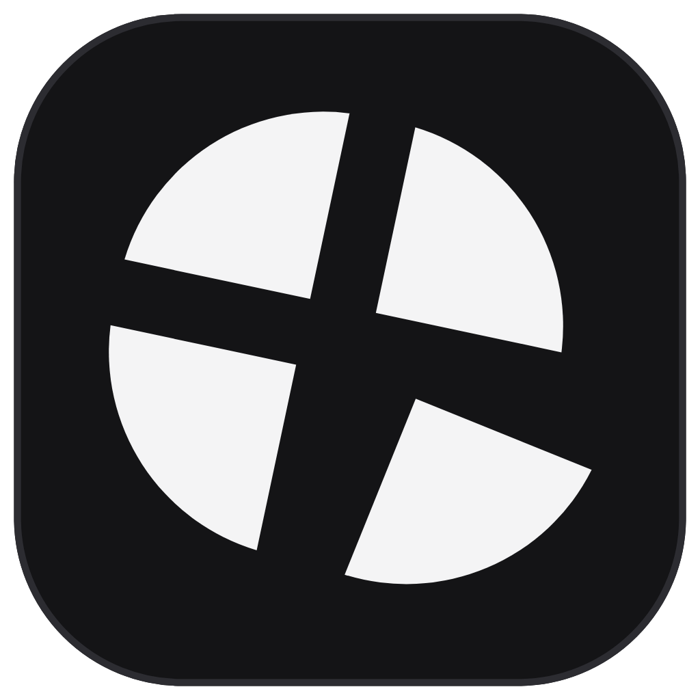

<h1 align="center">Riftline</h1>

A fast, account-safe launcher for the official Roblox app on Windows.

<a href="https://github.com/okayzel/riftline/releases/latest/download/Riftline-Setup.exe"><b>⬇ Download for Windows</b></a>

---

## What it does

- **Quick launches.** One click (or a desktop shortcut) into your favourite game, on the best-ping, emptiest or nearest server.
- **Server card.** See which city the server you just joined is in.
- **FPS counter and benchmarks.** Measured from Windows, with 1% lows.
- **Lag doctor.** Tells you what's actually slowing the game down (graphics card, processor, memory or a background app) and what to do about it.
- **Saved servers.** Bookmark a good server and rejoin it later, or rejoin your last one from the tray.
- **Per-game settings.** Different sensitivity, graphics and volume for each game.
- **Boost loadouts.** FPS cap, Game Mode and priority, all switched back when you're done.
- **Crash and disconnect help.** Plain-English explanations and fixes.
- **Auto-updates.** Signed, so a copy only installs updates that really come from Riftline.

## Account safety

Riftline never injects into, patches or reads the memory of the Roblox app, never sends it input, and never asks for or stores your login cookie. It only uses the official Roblox app, its official settings files, its log files and public web APIs.

## Installing

1. Download **Riftline-Setup.exe** using the button above.
2. Run it. It installs just for your Windows account, so no admin prompt.
3. Windows may show **"Windows protected your PC"** because Riftline is new and not yet code-signed. Click **More info → Run anyway**.

Windows 10 or 11, 64-bit. To uninstall, go to Settings → Apps → Installed apps → Riftline. Uninstalling puts back anything Riftline changed.

---

Riftline is an independent project and is not affiliated with, endorsed by or sponsored by Roblox Corporation. Roblox is a trademark of Roblox Corporation.
